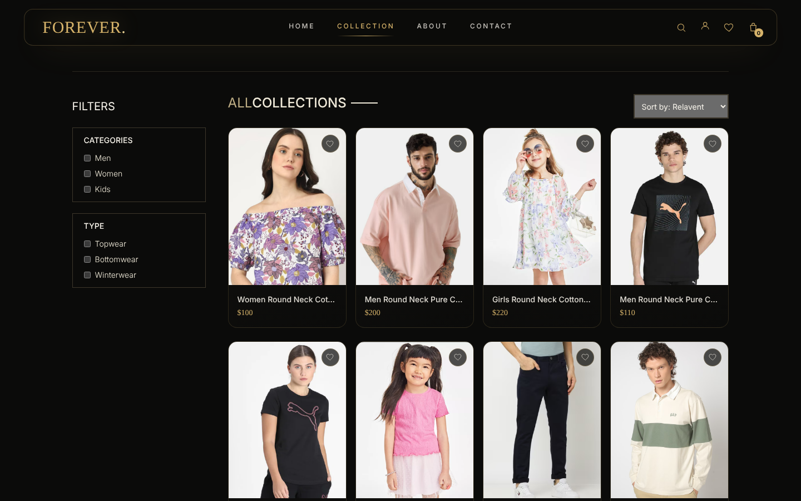
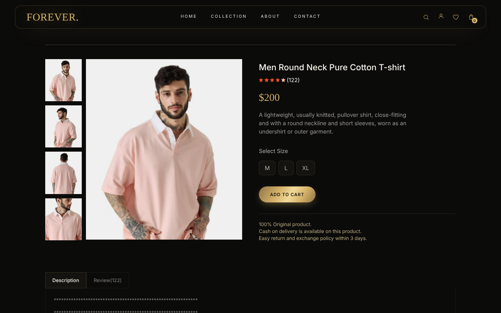
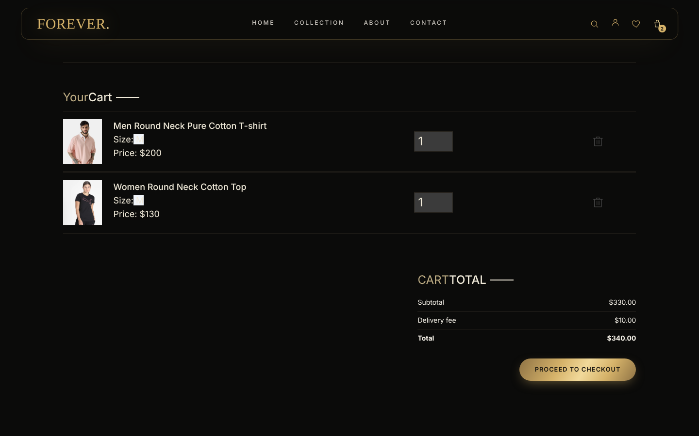
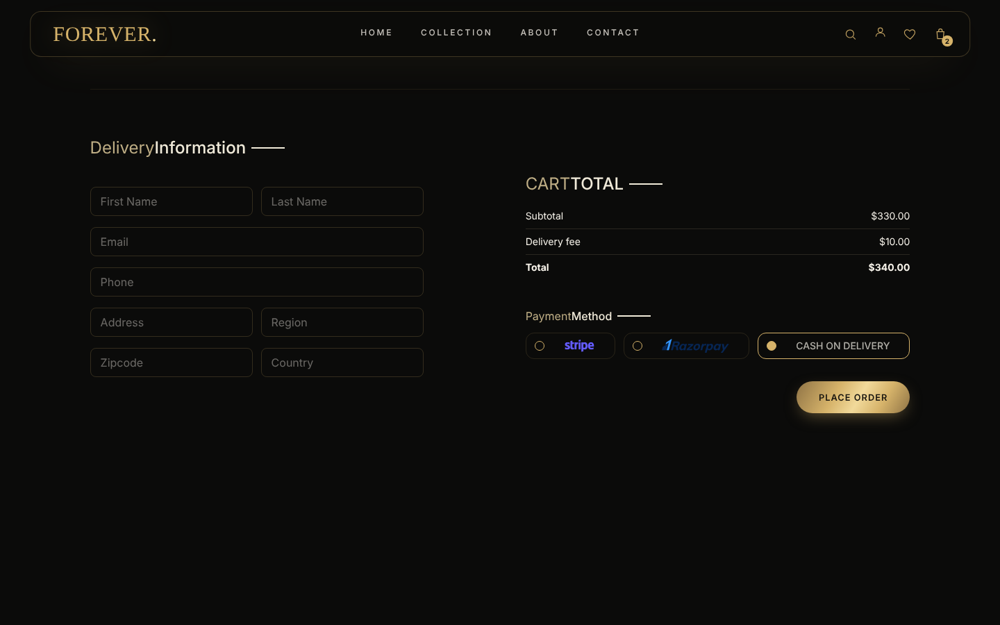
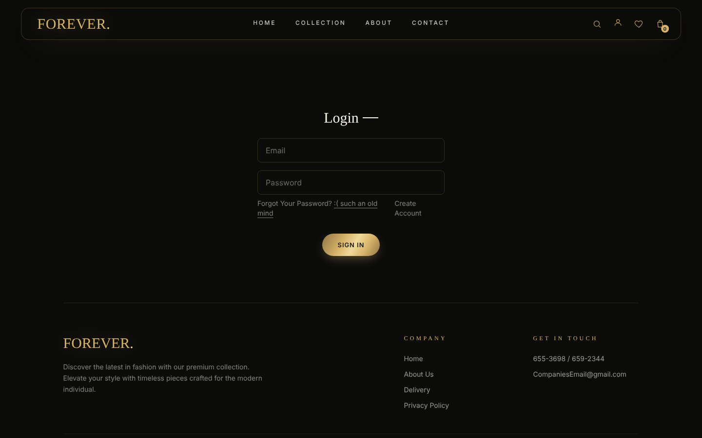
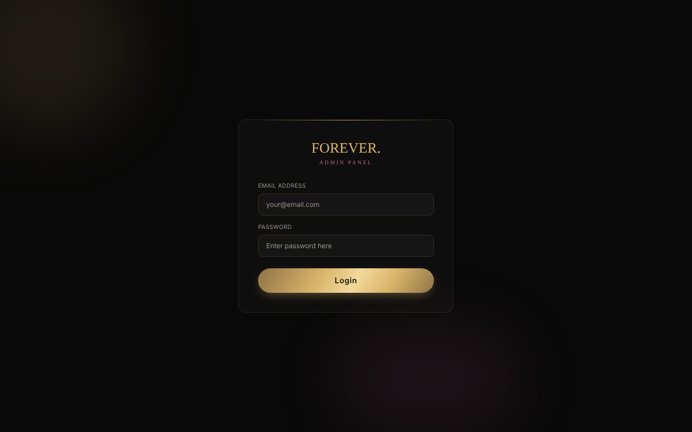
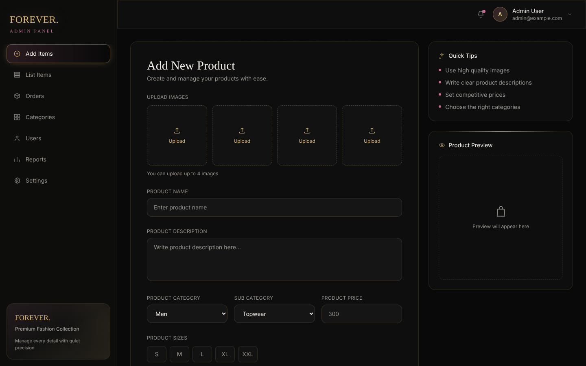
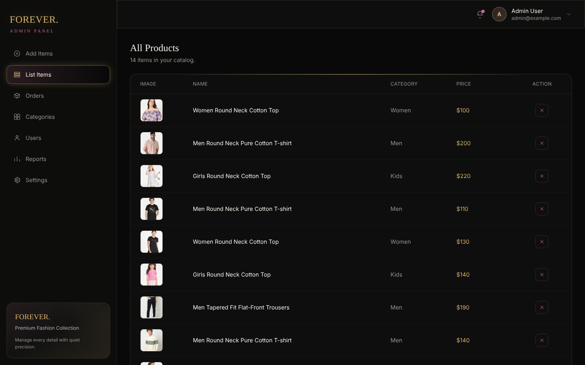
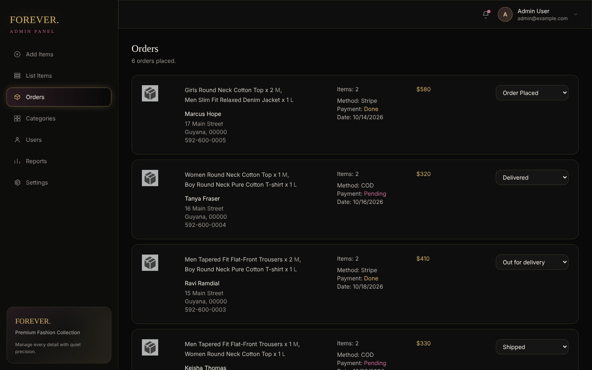
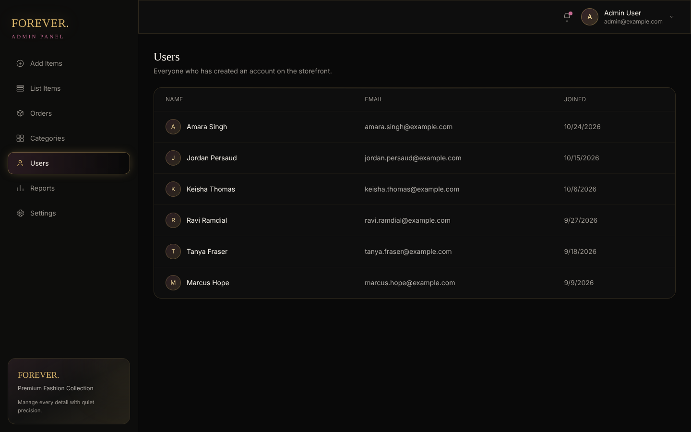

# Forever — Full-Stack E-Commerce Store

A full-stack fashion e-commerce platform with a customer storefront, a separate admin panel, and a REST API. Shoppers can browse and filter the catalogue, pick sizes, manage a cart and check out with Stripe, Razorpay or cash on delivery. Store staff manage products, orders and customers from the admin panel.

The storefront and admin panel are both React + Vite apps styled with Tailwind CSS in a dark, gold-accented "luxury" visual system. The backend is Express + MongoDB with JWT authentication and Cloudinary image uploads.

## Screenshots

### Storefront

| Home | Collection |
|------|------------|
|  |  |

| Product page | Cart |
|--------------|------|
|  |  |

| Checkout | Sign in |
|----------|---------|
|  |  |

| Mobile |
|--------|
|  |

### Admin panel

| Admin sign in | Add product |
|---------------|-------------|
|  |  |

| Product list | Orders |
|--------------|--------|
|  |  |

| Customers |
|-----------|
|  |

> Admin screenshots use sample orders and customers.

## Features

### Storefront
- **Home page** with hero banner, shop-by-category, latest collection and best sellers
- **Collection page** with category (Men / Women / Kids) and type (Topwear / Bottomwear / Winterwear) filters, sorting and search
- **Product pages** with an image gallery, size picker, description/reviews tabs and related products
- **Cart** with per-size quantities, live totals and delivery fee
- **Checkout** with delivery details and a choice of Stripe, Razorpay or cash on delivery
- **Accounts** — register, sign in, and view your order history and delivery status
- **Responsive layout** with a mobile menu, plus a light/dark theme toggle
- Falls back to a built-in product catalogue if the API is unreachable, so the storefront still renders

### Admin panel
- Secure admin sign-in
- **Add products** with up to 4 images, category, sub-category, price, sizes and a best-seller flag
- **Product list** with delete
- **Orders** — see every order with items, customer address, payment method and payment status, and move it through *Order Placed → Packing → Shipped → Out for delivery → Delivered*
- **Customers** — list of registered users and join dates

### Backend API
- JWT authentication for customers and a separate admin login
- Product CRUD with image upload via Multer + Cloudinary
- Server-side cart stored per user
- Order placement for cash on delivery, Stripe Checkout and Razorpay, with payment verification
- Configurable CORS for deployed front ends

## Tech stack

| Layer | Technologies |
|-------|--------------|
| Storefront | React 18, React Router 7, Vite, Tailwind CSS, Axios, React Toastify |
| Admin panel | React 19, React Router 7, Vite, Tailwind CSS, Axios, React Toastify |
| Backend | Node.js, Express, MongoDB + Mongoose, JWT, bcrypt, Multer, Cloudinary |
| Payments | Stripe, Razorpay, cash on delivery |
| Hosting | Netlify (storefront at `/`, admin panel at `/admin`) |

## Project structure

```
Ecommerence/
├── frontend/      # Customer storefront (React + Vite)
├── Admin/         # Admin panel (React + Vite, served under /admin)
├── Backend/       # Express REST API
│   ├── config/        # MongoDB and Cloudinary setup
│   ├── controllers/   # User, product, cart and order logic
│   ├── middleware/    # Auth, admin auth, file uploads
│   ├── models/        # Mongoose models
│   └── routes/        # API routes
└── netlify.toml   # Builds storefront + admin into one deployment
```

## API overview

| Route | Description |
|-------|-------------|
| `POST /api/user/register` · `POST /api/user/login` | Customer accounts |
| `POST /api/user/adminlogin` | Admin sign-in |
| `GET /api/product/list` · `POST /api/product/single` | Browse products |
| `POST /api/product/add` · `DELETE /api/product/remove/:id` | Manage products (admin) |
| `POST /api/cart/get` · `/add` · `/update` | Customer cart |
| `POST /api/order/place` · `/stripe` · `/razorpay` | Place an order |
| `POST /api/order/userorders` | Customer order history |
| `POST /api/order/list` · `/status` | Manage orders (admin) |

## Getting started

**Requirements:** Node.js 18+, a MongoDB database and a Cloudinary account. Stripe and Razorpay keys are optional.

### 1. Backend

```bash
cd Backend
npm install
cp .env.example .env   # then fill in your own values
npm run server         # starts on http://localhost:4000
```

### 2. Storefront

```bash
cd frontend
npm install
npm run dev            # http://localhost:5173
```

### 3. Admin panel

```bash
cd Admin
npm install
npm run dev            # http://localhost:5174
```

Both front ends talk to `http://localhost:4000` by default. Set `VITE_BACKEND_URL` to point them at a deployed API.

### Environment variables (Backend/.env)

| Variable | Purpose |
|----------|---------|
| `MONGODB_URI` | MongoDB connection string |
| `CLOUDINARY_NAME`, `CLOUDINARY_API_KEY`, `CLOUDINARY_SECRET_KEY` | Product image uploads |
| `JWT_SECRET` | Signs login tokens |
| `ADMIN_EMAIL`, `ADMIN_PASSWORD` | Admin panel login |
| `STRIPE_SECRET_KEY` | Optional — enables Stripe checkout |
| `RAZORPAY_KEY_ID`, `RAZORPAY_KEY_SECRET` | Optional — enables Razorpay checkout |
| `ALLOWED_ORIGINS` | Comma-separated front-end URLs allowed by CORS |
| `PORT` | API port (default 4000) |

## Deployment

`netlify.toml` builds the storefront and admin panel together: the storefront is served at the site root and the admin panel under `/admin`, with SPA redirects for both. Deploy the `Backend` separately (e.g. Render or Railway) and set `VITE_BACKEND_URL` and `ALLOWED_ORIGINS` to match.

## Author

**Deshawn Mitchell** — [GitHub @dezh19](https://github.com/dezh19)
